# PlagCheck — kompletny przewodnik: od zera do działającej strony

Ten przewodnik prowadzi krok po kroku przez: założenie darmowego serwera w Oracle Cloud,
wgranie aplikacji z Twojego komputera i korzystanie z niej. Nie wymaga GitHuba ani
przekazywania komukolwiek haseł czy kluczy — wszystko robisz sam, u siebie.

**Czas:** ok. 45 minut (w tym ~15 min automatycznej instalacji).
**Koszt:** 0 zł (zasoby Always Free).
**Potrzebujesz:** karty płatniczej (tylko do weryfikacji konta Oracle) i komputera z Windows 10/11, macOS lub Linuksem.

---

## Spis treści

0. [Co dostaniesz — jak wygląda aplikacja](#0-co-dostaniesz--jak-wygląda-aplikacja)
1. [Konto Oracle Cloud](#1-konto-oracle-cloud)
2. [Utworzenie maszyny wirtualnej](#2-utworzenie-maszyny-wirtualnej)
3. [Otwarcie portów 80 i 443](#3-otwarcie-portów-80-i-443)
4. [Przygotowanie komputera: paczka i klucz SSH](#4-przygotowanie-komputera-paczka-i-klucz-ssh)
5. [Wgranie i instalacja — jedno polecenie](#5-wgranie-i-instalacja--jedno-polecenie)
6. [Pierwsze uruchomienie](#6-pierwsze-uruchomienie)
7. [Jak korzystać z aplikacji](#7-jak-korzystać-z-aplikacji)
8. [Konfiguracja: domena, klucze API, limity](#8-konfiguracja-domena-klucze-api-limity)
9. [Aktualizacja do nowej wersji](#9-aktualizacja-do-nowej-wersji)
10. [Kopie zapasowe i przywracanie](#10-kopie-zapasowe-i-przywracanie)
11. [Rozwiązywanie problemów](#11-rozwiązywanie-problemów)
12. [Koszty, bezpieczeństwo, prywatność](#12-koszty-bezpieczeństwo-prywatność)
13. [Ściąga poleceń](#13-ściąga-poleceń)

---

## 0. Co dostaniesz — jak wygląda aplikacja

PlagCheck to **strona internetowa**: pod głównym adresem jest strona z opisem narzędzia
(landing page), a pod `/app` — sama aplikacja. Po instalacji otwierasz ją w dowolnej
przeglądarce — na komputerze lub telefonie — pod adresem w rodzaju
`https://152-70-1-2.sslip.io` albo pod własną domeną, np. `https://plagiat.mojadomena.pl`.
Nie trzeba niczego instalować na komputerach użytkowników.

Dostęp chroni **klucz dostępu** — wpisuje się go raz w przeglądarce. Każda przeglądarka
ma własną, anonimową historię sprawdzeń (bez kont i haseł).

| Ekran | Co robi |
|-------|---------|
| **Nowe sprawdzenie** | wgranie pliku DOCX/PDF/ODT/TXT lub wklejenie tekstu, wybór zakresu analizy |
| **Postęp** | pasek postępu; można zamknąć kartę i wrócić później |
| **Raport** | % podobieństwa, % prawdopodobieństwa AI, tekst z podświetleniami, źródła, parafrazy, frazy kontrolne |
| **Historia** | lista sprawdzeń z tej przeglądarki (raporty znikają po 72 h) |
| **Baza lokalna** | Twoje pliki referencyjne (np. wcześniejsze prace), z którymi porównywane są nowe teksty |

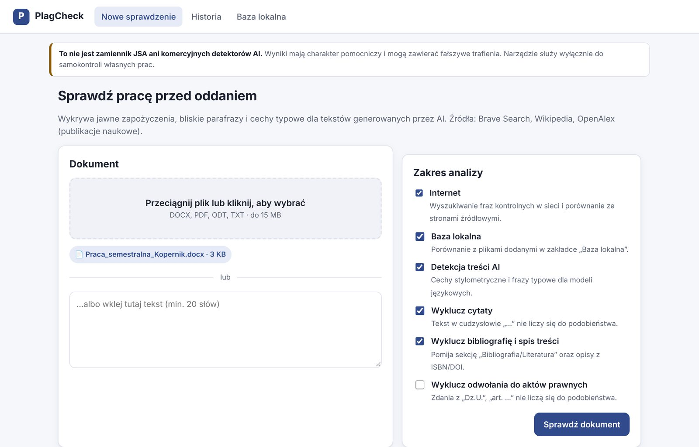
*Ekran startowy: wybór pliku i zakresu analizy. U góry stałe zastrzeżenie, że to nie jest zamiennik JSA.*

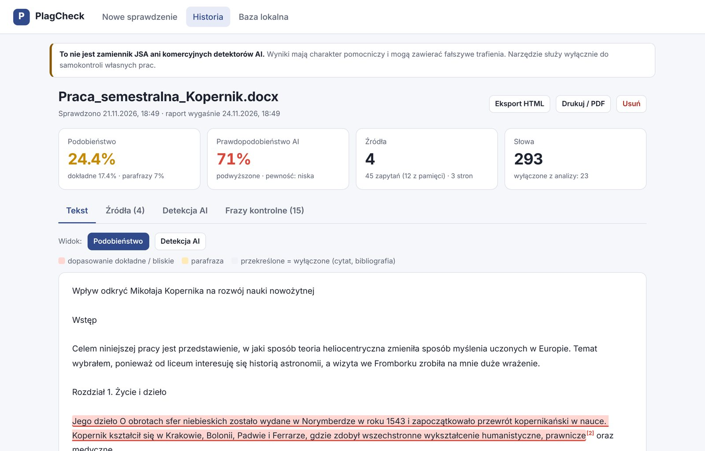
*Raport: wskaźniki i tekst z podświetleniami — czerwone = dopasowanie dosłowne lub bliskie, żółte = parafraza, przekreślone = wyłączone (cytaty, bibliografia). Numer w nawiasie wskazuje źródło.*

Pozostałe ekrany pokazuje [rozdział 7](#7-jak-korzystać-z-aplikacji).

---

## 1. Konto Oracle Cloud

1. Wejdź na <https://www.oracle.com/cloud/free/> → **Start for free**.
2. Podaj e-mail, kraj (Poland), dane i kartę płatniczą — Oracle pobiera i zwraca symboliczną kwotę weryfikacyjną.
3. **Home Region — wybierz uważnie, nie da się go zmienić.** Darmowe maszyny ARM działają tylko
   w regionie domowym. Wybierz region najbliższy Polsce dostępny na liście, np.
   **Germany Central (Frankfurt)** lub **Netherlands Northwest (Amsterdam)**.
4. Po aktywacji konta (zwykle kilka minut, czasem do godziny) zaloguj się do konsoli:
   <https://cloud.oracle.com>.

### Zalecane: przejście na „Pay As You Go” (nadal 0 zł)

*Menu (☰) → Billing & Cost Management → Upgrade and Manage Payment → Upgrade to Pay As You Go.*

- Zasoby **Always Free pozostają darmowe** — płaci się tylko za to, co przekracza darmowe limity
  (w tym przewodniku nic nie przekracza).
- Rozwiązuje dwa realne problemy darmowego konta: Oracle **może odebrać instancję**, która przez
  tydzień prawie nie używa CPU (typowe dla aplikacji używanej okazjonalnie), a tworzenie maszyny
  ARM często kończy się błędem **„Out of capacity”**.
- Dla spokoju ustaw alert: *Billing → Budgets → Create Budget* — kwota 1 zł, powiadomienie e-mail.

---

## 2. Utworzenie maszyny wirtualnej

*Menu (☰) → Compute → Instances → **Create instance***

> Nazwy przycisków w konsoli Oracle bywają zmieniane — szukaj odpowiedników opisanych niżej.

| Sekcja | Co ustawić |
|--------|-----------|
| **Name** | np. `plagcheck` |
| **Placement** | zostaw domyślne (przy błędzie „Out of capacity” zmień *Availability Domain* na inną) |
| **Image and shape → Shape** | *Change shape* → **Ampere** → **VM.Standard.A1.Flex** → **2 OCPU**, **12 GB** pamięci |
| **Image and shape → Image** | *Change image* → **Ubuntu** → **Canonical Ubuntu 24.04** (wersja dla ARM/aarch64 wybierze się sama) |
| **Networking** | *Create new virtual cloud network* + *Create new public subnet*; zaznacz **Automatically assign public IPv4 address** |
| **Add SSH keys** | **Generate a key pair for me** → kliknij **Save private key** (plik `ssh-key-….key`) — **zachowaj go, bez niego nie zalogujesz się do serwera** |
| **Boot volume** | zostaw domyślne (~47 GB) |

Kliknij **Create**. Po 1–3 minutach status zmieni się na **Running**.
Na stronie instancji skopiuj **Public IP address** (np. `152.70.1.2`) — będzie potrzebny dalej.

> Darmowy limit ARM to łącznie 4 OCPU / 24 GB RAM. 2 OCPU / 12 GB w zupełności wystarcza
> i zostawia zapas na drugą maszynę.

---

## 3. Otwarcie portów 80 i 443

Oracle ma **dwie zapory**: w systemie maszyny (tę otworzy instalator) i w sieci chmurowej VCN
(tę musisz otworzyć w konsoli — **bez tego strona nie otworzy się z internetu**).

1. Na stronie instancji, w sekcji **Primary VNIC**, kliknij nazwę **Subnet** (podsieci).
2. Przejdź do **Security Lists** (w nowszej konsoli: zakładka *Security*) → **Default Security List for …**.
3. **Add Ingress Rules** — dodaj dwie reguły:

| Source Type | Source CIDR | IP Protocol | Destination Port Range |
|-------------|-------------|-------------|------------------------|
| CIDR | `0.0.0.0/0` | TCP | `80` |
| CIDR | `0.0.0.0/0` | TCP | `443` |

(Opcjonalnie trzecia: UDP `443` — szybszy protokół HTTP/3.)
Reguła dla portu 22 (SSH) już istnieje — nie usuwaj jej.

---

## 4. Przygotowanie komputera: paczka i klucz SSH

### 4.1. Pliki

W jednym folderze (np. `Pobrane`) umieść:
- paczkę **`plagcheck-oracle-1.3.0.tar.gz`**,
- klucz prywatny z kroku 2 — dla wygody zmień jego nazwę na **`oracle.key`**.

### 4.2. Terminal

- **Windows 10/11:** menu Start → wpisz **PowerShell** → otwórz. (SSH jest wbudowany w system.)
- **macOS:** Launchpad → **Terminal**.
- **Linux:** dowolny terminal.

Przejdź do folderu z plikami:

```bash
cd Downloads          # albo: cd Pobrane
```

### 4.3. Uprawnienia klucza (jednorazowo)

SSH odrzuci klucz, który mogą czytać inni użytkownicy komputera.

**Windows (PowerShell):**
```powershell
icacls .\oracle.key /inheritance:r /grant:r "$($env:USERNAME):(R)"
```

**macOS / Linux:**
```bash
chmod 600 oracle.key
```

### 4.4. Test połączenia (opcjonalnie)

```bash
ssh -i oracle.key ubuntu@152.70.1.2
```

(wstaw swój IP). Przy pierwszym połączeniu wpisz `yes`. Jeśli zobaczysz `ubuntu@plagcheck:~$`,
wszystko działa — wyjdź poleceniem `exit`.

---

## 5. Wgranie i instalacja — jedno polecenie

Wklej do terminala (zamień **oba** wystąpienia `152.70.1.2` na swój IP):

**Windows (PowerShell), macOS, Linux — identycznie:**

```bash
scp -i oracle.key plagcheck-oracle-1.3.0.tar.gz ubuntu@152.70.1.2: ; ssh -t -i oracle.key ubuntu@152.70.1.2 "tar -xzf plagcheck-oracle-1.3.0.tar.gz && sudo bash plagcheck-oracle-1.3.0/setup.sh"
```

**Z własną domeną** (najpierw rekord DNS typu **A**: `plagiat.mojadomena.pl → 152.70.1.2`):

```bash
scp -i oracle.key plagcheck-oracle-1.3.0.tar.gz ubuntu@152.70.1.2: ; ssh -t -i oracle.key ubuntu@152.70.1.2 "tar -xzf plagcheck-oracle-1.3.0.tar.gz && sudo bash plagcheck-oracle-1.3.0/setup.sh --domain plagiat.mojadomena.pl"
```

### Co się dzieje (ok. 10–15 minut)

```
==> System: Ubuntu 24.04 LTS · aarch64
==> Profil: full (RAM: 11 954 MB)
==> Instalacja Dockera
==> Otwieranie portów 80/443 w zaporze systemu
==> Kopiowanie aplikacji do /opt/plagcheck
==> Tworzenie konfiguracji /opt/plagcheck/.env
==> Budowanie i uruchamianie (profil full — pierwszy build full trwa ok. 5–15 min)
==> Czekam na start aplikacji

==> Gotowe! PlagCheck 1.3.0
    Adres:          https://152-70-1-2.sslip.io/
    Klucz dostępu:  Xk3vP9qLm2RtWz7a
```

**Zapisz adres i klucz dostępu** (np. w menedżerze haseł). Klucz jest też w pliku
`/opt/plagcheck/.env` na serwerze.

> **Bez własnej domeny** aplikacja dostaje adres `https://<IP-z-myślnikami>.sslip.io` —
> darmowy serwis DNS, dzięki któremu działa prawdziwy certyfikat HTTPS bez kupowania domeny.

---

## 6. Pierwsze uruchomienie

1. Otwórz w przeglądarce adres z instalatora. Zobaczysz **stronę główną** PlagCheck z opisem
   narzędzia — kliknij **Otwórz aplikację** (sama aplikacja jest pod adresem `…/app`).
   Jeśli przez pierwsze 1–2 minuty pojawia się błąd certyfikatu, odczekaj — serwer właśnie
   pobiera certyfikat z Let's Encrypt.
2. Wybierz plik i kliknij **Sprawdź dokument**. Przy pierwszym użyciu aplikacja poprosi o
   **klucz dostępu** — wklej go i zatwierdź. Przeglądarka go zapamięta.

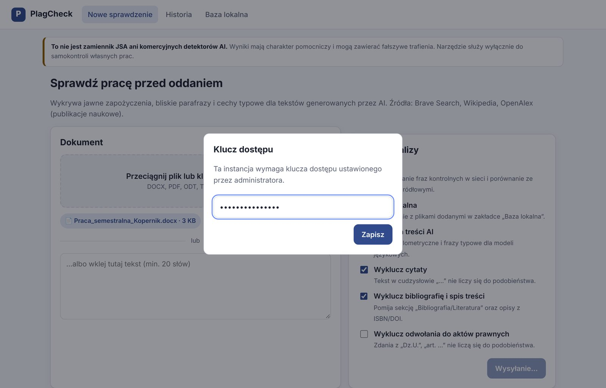

---

## 7. Jak korzystać z aplikacji

### Nowe sprawdzenie

Przeciągnij plik (DOCX, PDF, ODT, TXT, do 15 MB) albo wklej tekst. W panelu **Zakres analizy**:

| Opcja | Znaczenie |
|-------|-----------|
| **Internet** | frazy z tekstu są wyszukiwane w Wikipedii, OpenAlex (publikacje naukowe) i — jeśli dodasz klucz — w wyszukiwarce internetowej |
| **Baza lokalna** | porównanie z plikami z zakładki *Baza lokalna* |
| **Detekcja treści AI** | szacunek, czy tekst ma cechy typowe dla modeli językowych |
| **Wyklucz cytaty** | tekst w cudzysłowie „…” nie liczy się do podobieństwa |
| **Wyklucz bibliografię i spis treści** | sekcja „Bibliografia/Literatura” i opisy z ISBN/DOI są pomijane |
| **Wyklucz odwołania do aktów prawnych** | zdania z „Dz.U.”, „art. …” nie liczą się do podobieństwa |

### Postęp

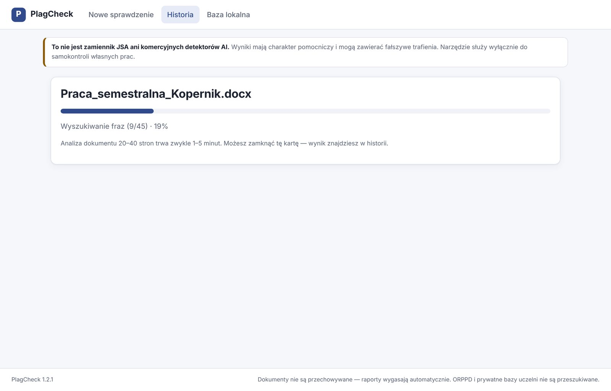

Analiza pracy 20–40 stron trwa zwykle 1–5 minut. Kartę można zamknąć — wynik pojawi się w **Historii**.

### Raport — tekst

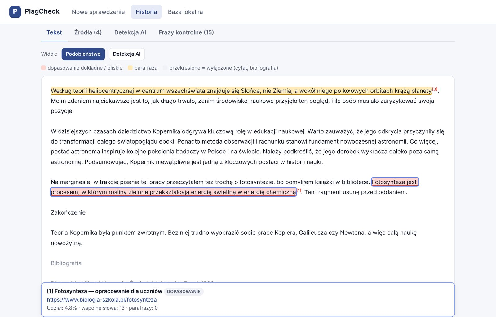
*Kliknięcie podświetlenia pokazuje źródło: tytuł, link, udział i — dla parafraz — fragment źródła.*

Przełącznik **Widok: Detekcja AI** koloruje fragmenty według szacowanego prawdopodobieństwa AI:

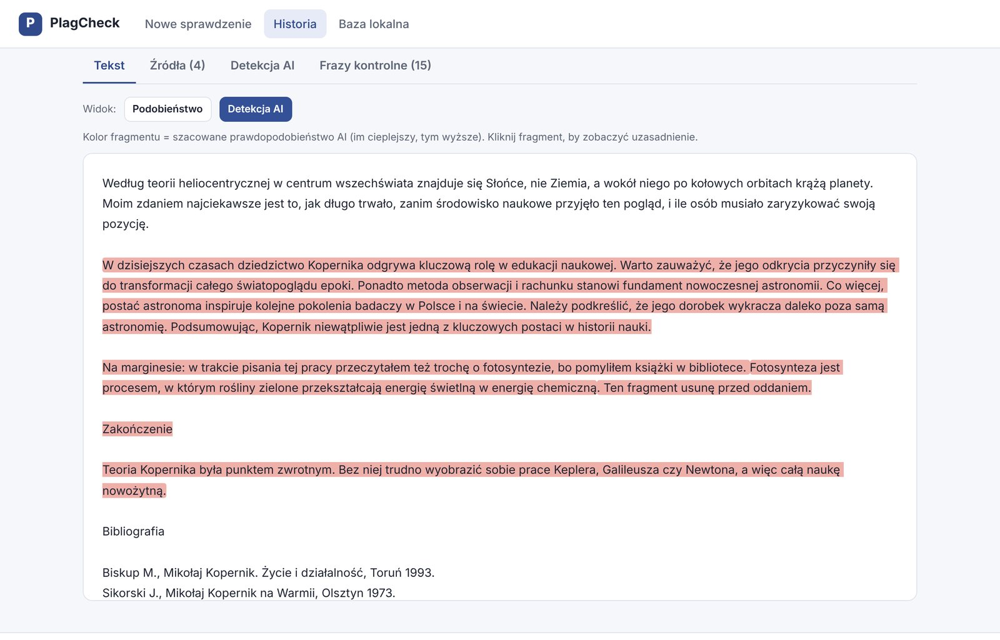

### Raport — źródła i parafrazy

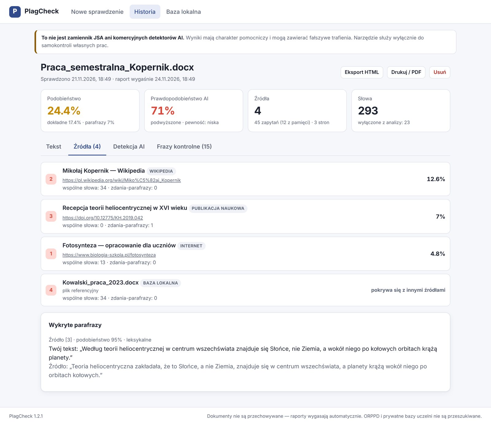
*Typy źródeł: internet, Wikipedia, publikacja naukowa, baza lokalna. „Udział” liczy każde słowo raz — jeśli ten sam fragment jest w kilku źródłach, przypisuje się go źródłu z największym wkładem.*

### Raport — detekcja AI

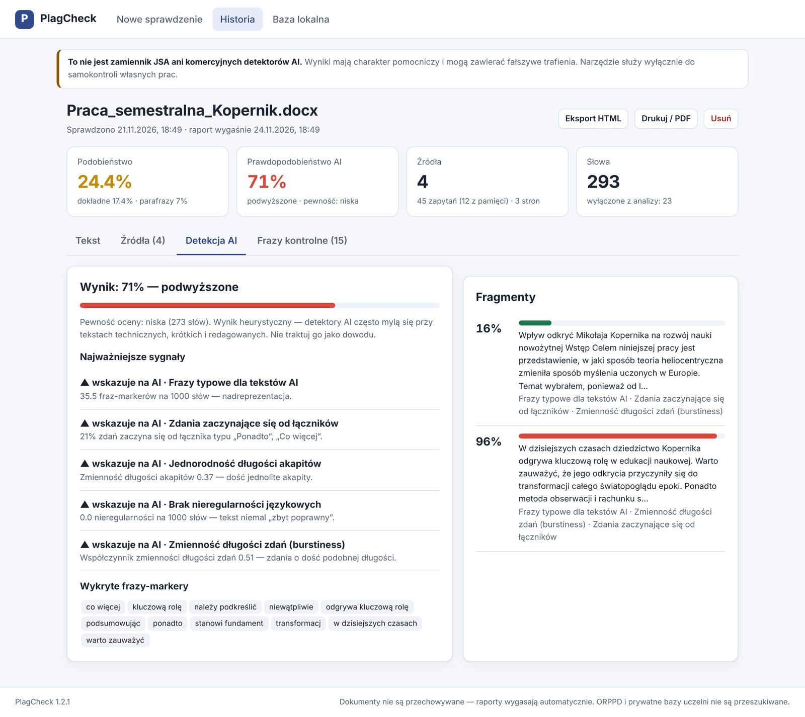
*Wynik z uzasadnieniem (które cechy wpłynęły na ocenę) i podziałem na fragmenty. To wskazówka, nie dowód — detektory AI często mylą się przy tekstach krótkich, technicznych i redagowanych.*

### Raport — frazy kontrolne

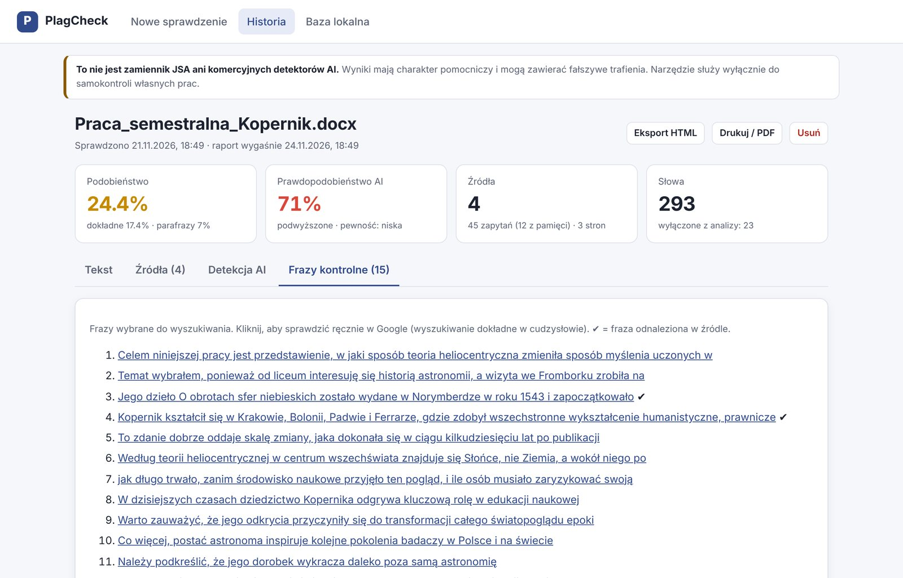
*Frazy wysłane do wyszukiwania. Każdą możesz sprawdzić ręcznie w Google (link otwiera wyszukiwanie dokładne w cudzysłowie).*

### Eksport i druk

**Eksport HTML** zapisuje samodzielny plik raportu; **Drukuj / PDF** → w oknie drukowania wybierz *Zapisz jako PDF*.

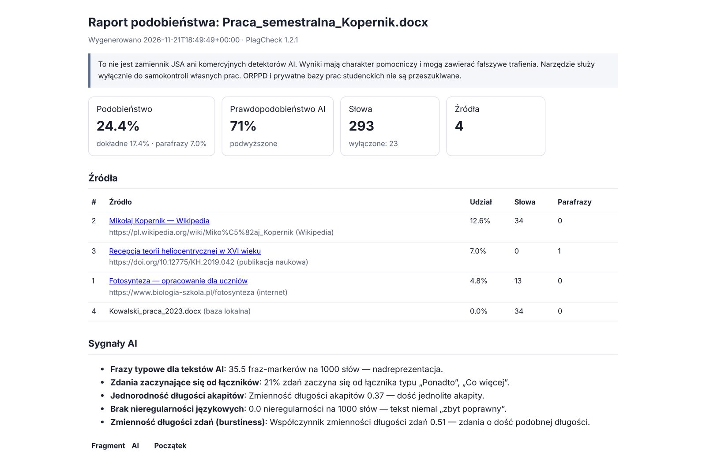

### Historia i baza lokalna

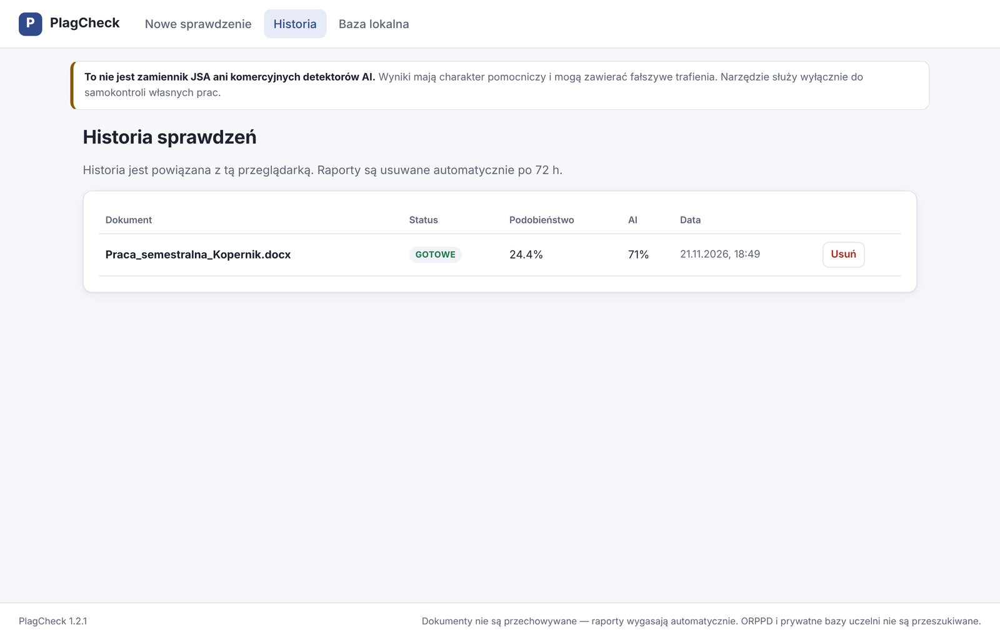

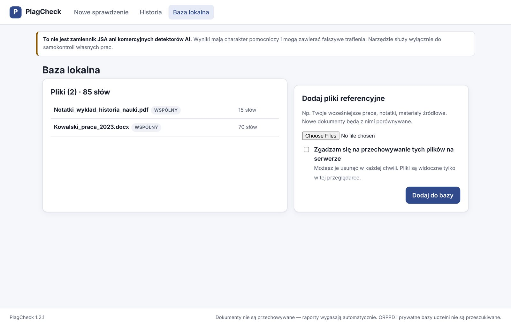
*Dodanie pliku do bazy wymaga zaznaczenia zgody na przechowywanie. Pliki „wspólne” dodaje administrator (patrz [rozdział 8](#baza-wspólna-dla-wszystkich-użytkowników)).*

### Telefon i ciemny motyw

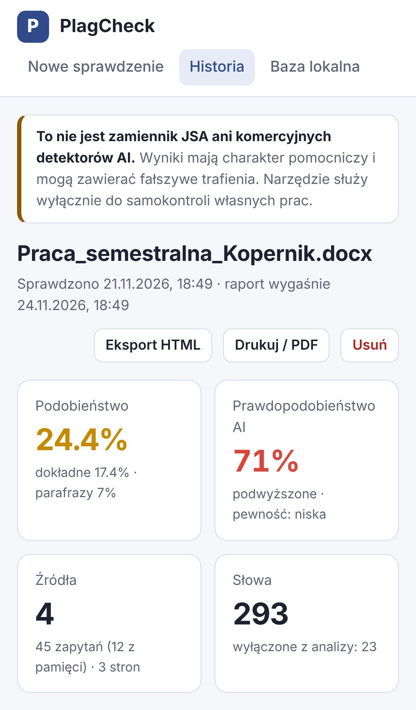

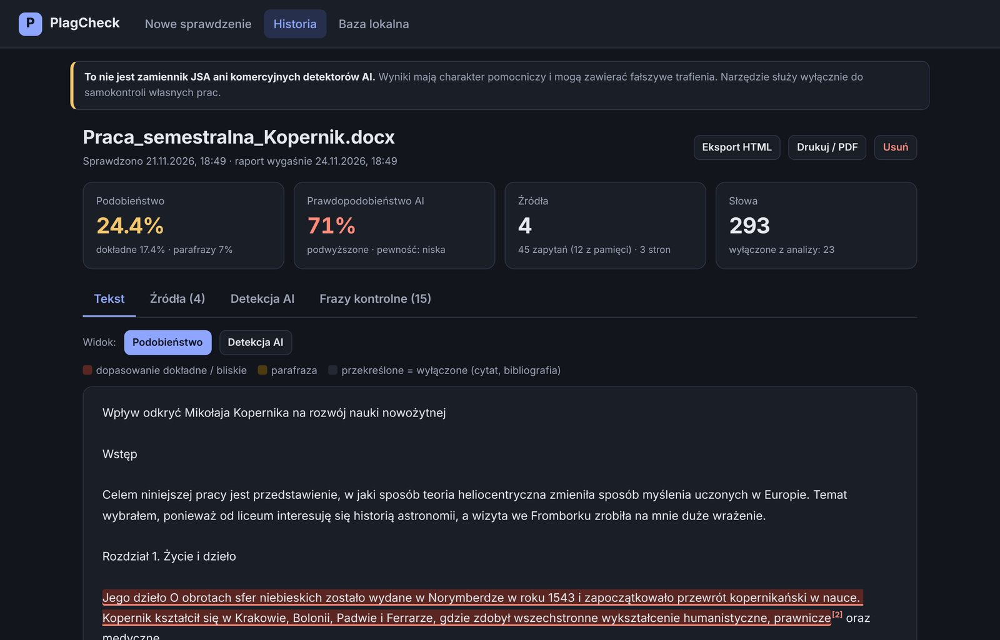
*Ciemny motyw włącza się automatycznie zgodnie z ustawieniami systemu.*

---

## 8. Konfiguracja: domena, klucze API, limity

Konfiguracja jest w pliku `/opt/plagcheck/.env` na serwerze. Edycja:

```bash
ssh -i oracle.key ubuntu@152.70.1.2
sudo nano /opt/plagcheck/.env          # zapis: Ctrl+O, Enter; wyjście: Ctrl+X
cd /opt/plagcheck && sudo docker compose --profile https up -d
```

| Ustawienie | Opis |
|------------|------|
| `ACCESS_KEY` | klucz dostępu do aplikacji |
| `BRAVE_API_KEY` / `SERPER_API_KEY` / `SERPAPI_API_KEY` | klucz wyszukiwarki internetowej — bez niego przeszukiwane są tylko Wikipedia i OpenAlex. Klucze uzyskasz na stronach <https://brave.com/search/api/>, <https://serper.dev>, <https://serpapi.com> (sprawdź aktualne darmowe limity) |
| `MAX_WEB_QUERIES` | ile fraz na dokument wysyłać do każdego źródła (domyślnie 25) |
| `REPORT_TTL_HOURS` | po ilu godzinach raporty są usuwane (domyślnie 72) |
| `PARAPHRASE_THRESHOLD`, `SEMANTIC_THRESHOLD` | czułość wykrywania parafraz (wyżej = mniej fałszywych trafień) |

### Zmiana adresu na własną domenę

Dodaj rekord DNS **A** `plagiat.mojadomena.pl → IP serwera`, odczekaj kilka minut i uruchom
ponownie instalator z `--domain` (polecenie z [rozdziału 9](#9-aktualizacja-do-nowej-wersji)).

### Baza wspólna dla wszystkich użytkowników

```bash
scp -i oracle.key -r moje_zrodla ubuntu@152.70.1.2:          # z Twojego komputera
ssh -i oracle.key ubuntu@152.70.1.2
cd /opt/plagcheck
sudo docker compose cp ~/moje_zrodla plagcheck:/data/zrodla
sudo docker compose exec plagcheck python -m app.worker import-refs /data/zrodla
```

---

## 9. Aktualizacja do nowej wersji

Dokładnie to samo polecenie co przy instalacji, z nową nazwą paczki:

```bash
scp -i oracle.key plagcheck-oracle-NOWA.tar.gz ubuntu@IP: ; ssh -t -i oracle.key ubuntu@IP "tar -xzf plagcheck-oracle-NOWA.tar.gz && sudo bash plagcheck-oracle-NOWA/setup.sh"
```

Konfiguracja (`.env`), klucz dostępu, historia i baza lokalna zostają zachowane.

---

## 10. Kopie zapasowe i przywracanie

Serwer codziennie zapisuje kopię bazy w `/var/backups/plagcheck/` (ostatnie 14 dni).

**Pobranie kopii na swój komputer:**
```bash
scp -i oracle.key "ubuntu@152.70.1.2:/var/backups/plagcheck/*" .
```
(jeśli pojawi się błąd uprawnień: na serwerze `sudo chmod 755 /var/backups/plagcheck && sudo chmod 644 /var/backups/plagcheck/*`)

**Przywrócenie kopii** (podmień datę w nazwie pliku):
```bash
cd /opt/plagcheck
sudo docker compose stop plagcheck
sudo docker compose run --rm --no-deps --user root -v /var/backups/plagcheck:/b --entrypoint sh plagcheck \
  -c "cp /b/plagcheck-2026-11-20.sqlite3 /data/plagcheck.sqlite3 && rm -f /data/plagcheck.sqlite3-wal /data/plagcheck.sqlite3-shm && chown 10001 /data/plagcheck.sqlite3"
sudo docker compose start plagcheck
```

---

## 11. Rozwiązywanie problemów

| Objaw | Przyczyna i rozwiązanie |
|-------|-------------------------|
| „Out of capacity” przy tworzeniu maszyny | brak wolnych maszyn ARM w tej strefie: zmień *Availability Domain*, spróbuj za kilka godzin lub przejdź na Pay As You Go |
| `Permission denied (publickey)` | zły klucz lub użytkownik: dla Ubuntu użytkownik to `ubuntu`; sprawdź ścieżkę `-i oracle.key` |
| `UNPROTECTED PRIVATE KEY FILE` | wykonaj krok 4.3 (uprawnienia klucza) |
| `Connection timed out` przy SSH | maszyna nie ma publicznego IP albo usunięto regułę portu 22 w Security List |
| strona nie otwiera się (timeout) | brak reguł Ingress 80/443 — [krok 3](#3-otwarcie-portów-80-i-443) |
| błąd certyfikatu przez dłużej niż 5 min | sprawdź krok 3, potem logi: `cd /opt/plagcheck && sudo docker compose logs caddy` |
| analiza kończy się błędem | `cd /opt/plagcheck && sudo docker compose logs --tail 100 plagcheck` |
| „Wymagany klucz dostępu” | klucz jest w `/opt/plagcheck/.env` (`ACCESS_KEY=`) |
| maszyna zniknęła po kilku tygodniach | odebrana jako bezczynna na darmowym koncie — przejdź na Pay As You Go ([rozdział 1](#zalecane-przejście-na-pay-as-you-go-nadal-0-zł)) i odtwórz z kopii |

Stan aplikacji na serwerze: `curl -s http://127.0.0.1:8000/api/health` — w odpowiedzi
`"profile": "full"` oznacza, że działa wykrywanie parafraz synonimicznych.

---

## 12. Koszty, bezpieczeństwo, prywatność

- **Koszt:** maszyna A1 2 OCPU / 12 GB, dysk ~47 GB i ruch sieciowy mieszczą się w Always Free — 0 zł.
- **HTTPS:** certyfikat Let's Encrypt odnawia się automatycznie.
- **Dostęp:** chroniony kluczem; nie udostępniaj go publicznie (każde sprawdzenie zużywa limity wyszukiwarek).
- **Klucz SSH:** trzymaj `oracle.key` tylko u siebie i zrób jego kopię (np. w menedżerze haseł) — bez niego nie zalogujesz się do serwera.
- **Prywatność dokumentów:** plik nie jest trwale zapisywany; tekst jest usuwany zaraz po analizie,
  raport po 72 h. Do wyszukiwarek trafia tylko kilkadziesiąt krótkich fraz, a model wykrywania
  parafraz działa na Twoim serwerze — treść pracy nie jest wysyłana do żadnej usługi AI.
- **Zastrzeżenie:** PlagCheck służy do samokontroli. Nie jest zamiennikiem JSA ani komercyjnych
  detektorów AI i nie przeszukuje ORPPD ani prywatnych baz uczelni.

---

## 13. Ściąga poleceń

| Cel | Polecenie |
|-----|-----------|
| zalogowanie na serwer | `ssh -i oracle.key ubuntu@IP` |
| logi aplikacji | `cd /opt/plagcheck && sudo docker compose logs -f plagcheck` |
| restart po zmianie `.env` | `cd /opt/plagcheck && sudo docker compose --profile https up -d` |
| stan | `curl -s http://127.0.0.1:8000/api/health` |
| ręczna kopia bazy | `sudo /etc/cron.daily/plagcheck-backup` |
| zatrzymanie | `cd /opt/plagcheck && sudo docker compose --profile https down` |
| aktualizacja | rozdział 9 |
